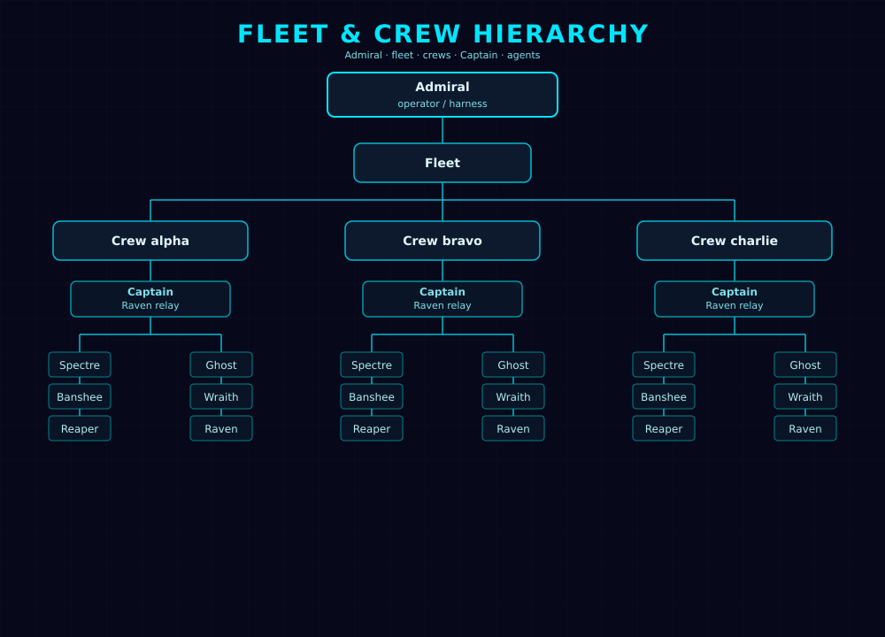

# Architecture

## Components

Transport spawn requests name the crew’s recorded backend, including Captain and scheduled dispatch.

**ga-transport** — the MCP server (`transport/server.py`). Runs as a container started by `podman-compose` from the `compose.yml` that `install.sh` generates. Manages crew containers via the Podman socket and exposes the `ghostship` MCP tools. Fronted by Caddy (`ga-portal`) — see [portal.md](portal.md).

**ga-portal (Caddy)** — publishes the main and per-crew dashboard listeners on `ga-portside`. Its admin API is bound to `/run/ga-portal-admin/admin.sock` on a dedicated Podman volume: Portal mounts it read-write and Transport read-only; the socket mode is `0600`. Radar and crew containers do not mount it, and no TCP admin listener or host mapping is configured. Transport uses this socket to register, remove, and restore per-crew dashboard routes.

For keyed installs, Transport also validates the original `gs_session` before its HTTP UI proxy wakes a crew or connects to its gateway. This preserves the session gate for requests that arrive directly from another internal container instead of through Caddy's `forward_auth` route.

**Crew containers** — on-demand KiroCrew instances (`localhost/spec-ops:latest`), named `gs-<id>`. Each has a workspace volume (`gs-vol-<id>`) and a home volume (`gs-home-<id>`). Created by `launch`, torn down by `nuke`. All join `ga-starboard` so the transport can reach them by name (`http://gs-<id>:5476`).

**Crew image** (`crews/spec-ops/Containerfile`) — extends the KiroCrew v0.13.0 base image pinned to index digest `sha256:f4c6c72656e60ed21fd02a86d2b631735660d58d9d0806f7b464acbd3ccb9a26` (bundled Kiro CLI 2.27.1). Built locally at install time as `localhost/spec-ops:latest` in three stages:

1. **`base-admission`** — mail stack and auth layer: installs `mailutils`, `msmtp-mta`, provisions Maildir structure, adds `maildeliver` and `verify-admiral-sig`.
2. **`spec-ops` comp** — adds Node.js 24 LTS and the `openspec` CLI. Optional backend toolchains (`claude`, `codex`) are layered here when enabled.
3. **`base-graduation`** — pre-seeds the kiro-cli SQLite DB schema so auth injection works at launch without running migrations.

See [configuration.md](configuration.md#extending-the-crew-image) to add packages.

## Ghost Academy



Every ghostship shares the same foundation: `academy/agents/`, `academy/skills/`, and `academy/steering/` — bind-mounted into the transport and copied into every crew at `launch`, filtered by the comp manifest (`crews/<comp>/manifest.json`).

### Agents

Six KiroCrew personas. The five workers split the [OpenSpec](https://github.com/Fission-AI/OpenSpec) spec-driven workflow; Raven is the Captain's dispatch persona.

| Agent | Role | Tool grants |
|:------|:-----|:------------|
| **Ghost** | General-purpose — executes one well-scoped task end to end; full OpenSpec lifecycle | `read grep glob write code shell web_search web_fetch` |
| **Spectre** | Planning — investigates, scaffolds proposals, revises plans | same as Ghost |
| **Banshee** | Review/fix — independent second pass; finds bugs, runs tests, fixes | same as Ghost |
| **Reaper** | Cleanup — syncs delta specs and archives completed changes | `read grep glob write shell web_search web_fetch` |
| **Wraith** | Recon/docs — research and documentation; read-only over code | `read grep glob shell web_search web_fetch` |
| **Raven** | Watcher/coordinator — checks task state, dispatches personas, drives the Captain loop | `read grep glob shell` |

Small, self-contained work can start and end with a single Ghost dispatch. Not every task needs the full cycle.

Academy content is bind-mounted into the transport, then `AcademyLoader._stage_skills()` stages manifest-selected skills from `/skills/` into `/home/kirocrew/.agents/skills/<skill-name>/` inside each crew. The baked `.agents/setup` script wires that shared skill tree to each backend's native path. Adding a backend requires an update to `.agents/setup`.

### OpenSpec workflow skills

The spec-ops image pairs OpenSpec CLI 2.1.0 with six core Academy skills and the selected optional `openspec-verify-change` skill. The six core skills are generated by `scripts/generate-openspec-skills.js`; the verifier is generated from the pinned CLI's verify template because the `repo-hygiene-sweep` Captain order requires it. Invoke skills with the backend's syntax: Codex uses `$openspec-*`; Kiro and Claude Code use `/openspec-*` (for example, `$openspec-apply-change` in Codex and `/openspec-apply-change` in Kiro or Claude Code). These are skills delivered from Academy; do not assume legacy OpenSpec command files are installed.

The `openspec-continue-change` skill is optional and is not in Academy's six-skill core set. When it is absent, use `openspec status --change "<name>" --json` to find the next ready artifact, then `openspec instructions "<artifact-id>" --change "<name>" --json` to get its requirements. Add `--store "<id>"` to those commands when the project is selected through a registered store.

### ghostship-spawn skill

Copied into every crew. Provides the four gateway operations not covered by the `kirocrew` CLI: named-persona dispatch, task detail, steering, and continuation. Sends cookie-authenticated requests only to the crew's fixed loopback gateway. Task input should stay short and describe commands rather than quote literal command lines. Dispatch uses `keep=true` so the returned `id` remains usable for status, steer, and continuation.

## Crew lifecycle

```
launch(crew_id, backend=None, profile=None)
  1. Resolve backend (given > transport default). Must be enabled.
  2. Resolve credential profile: explicit profile > single-profile implicit > "default".
     Check credentials before creating a crew. Missing `default` → start its login flow
     (or report one pending), then call launch again. Missing named profile → return
     `not_authenticated`; run `ghostship auth login <backend> --profile <name>` first.
  3. Create volumes: gs-vol-<id> + gs-home-<id>
  4. Generate Admiral Ed25519 keypair; register public key as Podman secret.
  5. Start crew container with the public key at /run/secrets/.admiral_public_key.
  6. Wait for gateway ready (:5476, 60 s timeout)
  7. Inject kiro-cli auth rows into SQLite DB
  8. Patch KiroCrew config (agents, memory thresholds, reasoning, subagent limits)
  9. Restart container (picks up auth + config)
  10. Wait for gateway ready again
  11. Copy agents, skills, steering from Academy bind-mount
  12. Seed shared OpenSpec store at workspace root
  13. Inject governance policy (HMAC-signed security_policy.json + admission_policy.json)
  14. Patch agent model files
  15. Mint session token, exchange for cookie
  16. Enroll all 6 personas (attested member-<slug> DM bindings)
  17. Register in crews.json → returns { status: "ready" } (~30 s)

nuke(crew_id, confirm=True)
  └── stop container, remove container + both volumes, deregister (run evac first if you need to preserve workspace data)
```

### Transport restart and on-demand recovery

When the transport starts, it checks registered crew containers against Podman and corrects their running/stopped status. A stopped crew stays stopped; startup does not start it to patch config, mint cookies, or wait for its gateway. Its registry entry, schedules, workspace and home volumes, and dashboard port remain available, so transport health can become ready without waiting for every crew gateway.

The first operation that needs a stopped crew wakes it through the normal recovery path. Recovery applies current transport config, refreshes gateway session cookies, enrolls crew members, and reconciles tracked schedules before serving the operation. UI, API, and WebSocket proxy requests wake their target crew as well.

Recovery starts the existing container from its existing image. It does not recreate the container from the latest `KC_IMAGE`; use `nuke` and `launch` when a crew must adopt a rebuilt image.

### Shared OpenSpec store

Every `dispatch` runs in its own `subagent_<task_id>/` subdirectory. `launch` seeds a shared OpenSpec store one level above at the workspace root (`openspec init --tools none --no-animation --force`), so all agents resolve to the same store automatically. The seeded store is a sibling of the delivered `repo/`; launch does not run `openspec update` against a user's project or apply the OpenSpec v1-to-v2 migration to its files.

### Repository transfer

Call `supply(path="repo", crew_id="<id>", bundle=True)` and POST a git bundle to the returned URL. For extraction, call `evac(path="repo", ..., bundle=True)` and clone the downloaded bundle.

**Presigned URLs are self-authenticating.** `evac`/`supply` URLs carry a short-lived HMAC token (`sig` + `expires`). Any HTTP client can use them without an `Authorization` header — both Caddy and `BearerAuthMiddleware` exempt `/files/` requests with a valid `sig`. An invalid or expired token returns HTTP 403.

## Captain supervision

`captain(crew_id, action="order", ...)` stores a recurring check-in in the transport registry. The Captain monitor wakes a stopped crew when that check-in is due, then continues or dispatches Raven using the existing task state. Future or disabled check-ins do not wake crews.

Captain starts one task per check-in by default. An order may authorize several independent work items; Raven starts them sequentially and reconciles each work-item identity, intent, and returned task ID before starting the next. Accepted tasks may then run concurrently. A memory-pressure deferral or uncertain admission stops further starts for that check-in; the next check-in reconciles prior intents before retrying. SDD multi-change mode admits at most one lifecycle step per change, while Indy and Sweepy pace their explicitly named review tasks.

Built-in templates:

| Template | Alias | What Raven does |
|:---------|:------|:----------------|
| `spec-driven-development` | `sdd` | Full OpenSpec lifecycle: Spectre → Ghost → Banshee → Reaper. `change_name` accepts a comma-separated list; one step per change may be admitted in a check-in, with starts paced sequentially. |
| `independent-review` | `indy` | Seven independent reviewers (Banshee × 6 for security/quality/test-coverage-a/b/c/privacy, Wraith for docs). Starts are paced; admitted reviewers may run concurrently. Memory pressure stops further starts for that check-in. Consolidated summary mailed to Admiral. Omit `change_name` for whole-codebase review. |
| `free-will` | `willy` | Open-ended: Raven executes `message=` with full autonomy and starts one task per check-in by default. Multiple starts require explicitly named independent work items. Self-cancels on completion. |
| `repo-hygiene-sweep` | `sweepy` | Use for repository-maintenance passes; Indy remains the change-review workflow. Runs strict OpenSpec validation/lifecycle status, spec-content and contradiction review, spec/code and docs coherence, plus a repository-wide privacy/sensitive-data sweep. Its four reviews start sequentially and may run concurrently after admission. Pass the absolute repository path in `message`; optionally pass comma-separated change names in `change_name`. Self-cancels after reporting; no edits, sync, or archive. |

`action="status"` reports job state and mailbox counts. `action="stop"` pauses without clearing history.

`transport://orders` returns the template index. `GA_ORDERS_DIR` lets operators add or override templates.

## Dispatch and sessions

Every `dispatch` requests a retained run (`keep=true`). Tasks run as isolated subagent processes in `subagent_<task_id>/` with no persistent session attached by default.

**Slot modes:**
- `slot=None` (default) — enrolled personas route into their attested `member-<slug>` dashboard session (~250 MB RSS); unenrolled personas run headless.
- `slot=False` — explicit headless, regardless of enrollment.
- `slot=True` — legacy value: logs a warning and falls back to `slot=None`; it does not create a per-task session. String-valued slots are invalid under the MCP tool's boolean-or-null input.
- Batch dispatch resolves the slot once and shares the same result across every task.

Dashboard port allocation controls browser visibility; it does not change slot resolution.

`steer(task_id, message, force=False)` — running tasks receive `/steer`; completed tasks use `/continue`. `force=True` hard-stops a running task first. On claude/codex backends the gateway may return `steer_unsupported`; transport falls back to `mode=follow_up` (`action: "follow_up_queued"`).

`pickup(task_id=None, timeout_secs=0)` — `timeout_secs=0` checks once; `>0` polls every 3 s. Always includes mail counts. Returns early with `reason: "admiral_mail"` if Admiral mail arrives during polling.

## Idle stop and auto-restart

Crews stop after `GA_IDLE_TIMEOUT_SECS` (default 300 s) of no activity. Active dispatches and cron executions refresh the timestamp. An enabled Captain schedule alone does not pin a crew alive.

`_ensure_crew_running` transparently restarts a stopped container before forwarding `dispatch`, `pickup`, `steer`, `evac`, `supply`, and `schedule` calls. Crew UI/API/WebSocket proxy requests use the same wake path. Concurrent starts are coordinated per crew and admitted against shared active-crew and memory limits.

Ghostship-tracked schedules and Captain check-ins can wake a stopped crew once their enabled work is due. Future or disabled tracked entries remain dormant. A cron job created only inside a crew gateway is invisible to the transport while that crew is stopped, so it cannot wake the crew. After an explicit wake, the gateway's cron state is queried again and gateway-owned jobs retain their gateway delivery behavior. Use Ghostship's `schedule()` tool when a job must wake a stopped crew automatically.

## Networking

Two static Podman networks; `ga-transport` joins both:

| Container | Network(s) |
|---|---|
| `ga-portal` | `ga-portside` only |
| `ga-radar` | `ga-portside` only |
| `ga-transport` | `ga-portside` + `ga-starboard` |
| `gs-{crew_id}` (crew) | `ga-starboard` only |
| `ga-login-*` (Kiro), `ga-claude-login-*`, `ga-codex-login-*` (ephemeral) | `ga-starboard` only |
| `gs-worker-{token}` (disposable) | none (`netns: none`) |

Crew and login containers on `ga-starboard` can dial `ga-transport` at the TCP layer, but are blocked at the application layer by `GA_TRANSPORT_SECRET`. `ga-portal` and `ga-radar` cannot resolve crew container names.

`GA_TRANSPORT_SECRET` is generated at install time, mounted into both Caddy and the transport. Caddy injects `X-Transport-Token` on every upstream request; the transport rejects any request missing it.

## Operator governance

Transport writes HMAC-signed governance policy files into `~/.kiro/crew/` inside each container during setup. The gateway enforces this ceiling — a tampered policy causes a signature mismatch at startup. Policy is set once at launch; to change it, nuke and relaunch.

Policy templates live in `academy/policies/`. The default (`default.json`) covers platform integrity: blocks `git push`, `gh`, pipe-to-shell, and messaging integrations. Custom templates are supported; see [configuration.md](configuration.md).

Claude and codex backend governance follows the same HMAC-signed policy model. Claude crews run under KiroCrew's hook gate (`default` mode). Codex crews use KiroCrew's `read-only` session mode as the mechanism — no approval-suppression flag is injected.

External network requirements: Claude crews need outbound access to `api.anthropic.com:443`; Codex crews need `api.openai.com:443` (or `OPENAI_BASE_URL`). The transport logs a warning at launch when these backends are used.

See [auth.md#admiral-mail-signing](auth.md#admiral-mail-signing) for the Ed25519 signing scheme and HMAC-SHA256 policy-signing details.

## Rebuilding images

> **Note:** `podman start` restarts an existing stopped container from its current state — it does **not** recreate it from the image. Only a fresh `nuke` + `launch` picks up changes to the image.

`podman start` restarts the existing container — it does not recreate from the current image. Only a fresh `nuke` + `launch` picks up a rebuilt image.

| You rebuilt... | What needs recreating |
|:----------------|:-----------------------|
| `transport/` | `./install.sh` (re-creates `ga-transport`, no crew impact) |
| `crews/spec-ops/Containerfile` | `nuke` + `launch` each affected crew (evac first) |

## Project layout

```
ghostship/
├── install.sh             # thin wrapper: delegates to bin/install.sh
├── ghostship              # CLI entry point (symlinked to ~/.local/bin/ghostship)
├── VERSION                # package version
├── bin/                   # install/uninstall/start scripts
│   ├── install.sh         # builds images, Podman service, runs transport
│   ├── start.sh           # starts Podman + ga-transport after reboot/stop
│   ├── uninstall.sh       # tears down transport; --purge-auth removes credentials
│   └── lib/               # shared Python modules (yaml_config, podman_setup, ...)
├── transport/             # MCP server
│   ├── server.py
│   ├── constants.py       # canonical infrastructure constants
│   ├── container_scripts/ # helper scripts baked into crew images
│   └── requirements.txt
├── radar/                 # fleet dashboard SPA + portside proxy
│   ├── server.py          # starlette app: serves static/, proxies /api/crews → transport
│   ├── Containerfile
│   ├── requirements.txt
│   └── static/            # HTML/CSS/JS baked into the image at build time
├── academy/               # Ghost Academy: shared agent pool
│   ├── agents/            # KiroCrew agent definitions (ghost, spectre, ...)
│   ├── skills/            # KiroCrew skills (openspec-*, ghostship-mail, ...)
│   ├── steering/          # Crew-wide standing context
│   ├── orders/            # Built-in Captain templates (sdd, indy, free-will)
│   └── policies/          # Governance policy templates
├── .claude-plugin/        # Agent Plugins + Claude Code plugin package
│   └── skills/
│       ├── ghostship-admin/       # install, connect, upgrade
│       ├── ghostship-capability/  # configure agent personas, skills, crew comps
│       └── ghostship-command/     # drive a connected fleet
├── config/                # ghostship.yaml.example
├── crews/                 # crew type definitions
│   ├── _base/             # base-admission + base-graduation stages
│   ├── _worker/           # minimal worker image (no openspec, no backends)
│   ├── registry.json      # comp registry
│   └── spec-ops/          # spec-ops comp (Node.js + openspec)
├── tests/                 # unit/, integration/, e2e/
├── openspec/              # this project's own OpenSpec state
└── docs/                  # documentation
```
