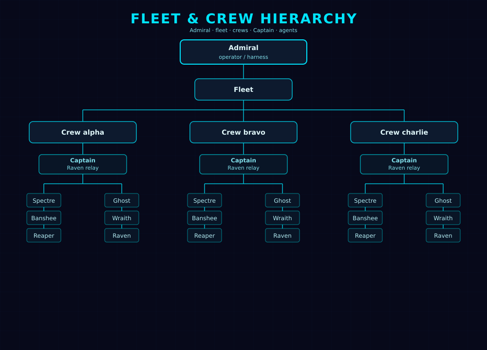

# Architecture

## Components

**ga-transport** — the MCP server (`transport/server.py`). Runs as a container started by `podman-compose` from the `compose.yml` that `install.sh` generates. Manages crew containers via the Podman socket and exposes the `ghostship` MCP tools. Fronted by Caddy (`ga-portal`) — see [portal.md](portal.md).

**Crew containers** — on-demand KiroCrew instances (`localhost/spec-ops:latest`), named `gs-<id>`. Each has a workspace volume (`gs-vol-<id>`) and a home volume (`gs-home-<id>`). Created by `launch`, torn down by `nuke`. All join `ga-starboard` so the transport can reach them by name (`http://gs-<id>:5476`).

**Crew image** (`crews/spec-ops/Containerfile`) — extends `ghcr.io/kirodotdev/kirocrew:0.10.0`. Built locally at install time as `localhost/spec-ops:latest` in three stages:

1. **`base-admission`** — mail stack and auth layer: installs `mailutils`, `msmtp-mta`, provisions Maildir structure, adds `maildeliver` and `verify-admiral-sig`.
2. **`spec-ops` composition** — adds Node.js 24 LTS and the `openspec` CLI. Optional backend toolchains (`claude`, `codex`) are layered here when enabled.
3. **`base-graduation`** — pre-seeds the kiro-cli SQLite DB schema so auth injection works at launch without running migrations.

See [configuration.md](configuration.md#extending-the-crew-image) to add packages.

## Ghost Academy



Every ghostship shares the same foundation: `academy/agents/`, `academy/skills/`, and `academy/steering/` — bind-mounted into the transport and copied into every crew at `launch`, filtered by the crew type's manifest (`crews/<crew-type>/manifest.json`).

### Agents

Six KiroCrew personas. The five workers split the [OpenSpec](https://github.com/Fission-AI/OpenSpec) spec-driven workflow; Raven is the Captain's dispatch persona.

| Agent | Role | Tool grants |
|:------|:-----|:------------|
| **Ghost** | General-purpose — executes one well-scoped task end to end; full OpenSpec lifecycle | `read grep glob write code shell web_search web_fetch` |
| **Spectre** | Planning — investigates, scaffolds proposals, revises plans | same as Ghost |
| **Banshee** | Review/fix — independent second pass; finds bugs, runs tests, fixes | same as Ghost |
| **Reaper** | Cleanup — syncs delta specs and archives completed changes | `read grep glob write shell web_search web_fetch` |
| **Wraith** | Recon/docs — research and documentation; read-only over code | `read grep glob shell web_search web_fetch` |
| **Raven** | Watcher/coordinator — checks task state, dispatches personas, drives the Captain loop | `read grep glob shell` |

Small, self-contained work can start and end with a single Ghost dispatch. Not every task needs the full cycle.

Academy content is delivered to each backend's native harness paths (`~/.kiro/skills/`, `~/.claude/skills/`, etc.) via `mcteamstar/.agents`, baked into every crew image and configured by `AcademyLoader` at launch. Adding a new backend requires no ghostship changes — only an update to `.agents/setup`.

### ghostship-spawn skill

Copied into every crew. Provides the four gateway operations not covered by the `kirocrew` CLI: named-persona dispatch, task detail, steering, and continuation. Sends cookie-authenticated requests only to the crew's fixed loopback gateway. Task input should stay short and describe commands rather than quote literal command lines. Dispatch uses `keep=true` so the returned `id` remains usable for status, steer, and continuation.

## Crew lifecycle

```
launch(crew_id, backend=None)
  1. Resolve backend (given > transport default). Must be enabled.
  2. Check credentials — missing → return login URL; call launch again after auth.
  3. Create volumes: gs-vol-<id> + gs-home-<id>
  4. Generate Admiral Ed25519 keypair; register public key as Podman secret.
  5. Start crew container with the public key at /run/secrets/.admiral_public_key.
  6. Wait for gateway ready (:5476, 60 s timeout)
  7. Inject kiro-cli auth rows into SQLite DB
  8. Patch KiroCrew config (agents, memory thresholds, reasoning, subagent limits)
  9. Restart container (picks up auth + config)
  10. Wait for gateway ready again
  11. Copy agents, skills, steering from Academy bind-mount
  12. Seed shared OpenSpec store at workspace root
  13. Inject governance policy (HMAC-signed security_policy.json + admission_policy.json)
  14. Patch agent model files
  15. Mint session token, exchange for cookie
  16. Enroll all 6 personas (attested member-<slug> DM bindings)
  17. Register in crews.json → returns { status: "ready" } (~30 s)

nuke(crew_id, confirm=True)
  └── stop container, remove container + both volumes, deregister (run evac first if you need to preserve workspace data)
```

### Shared OpenSpec store

Every `dispatch` runs in its own `subagent_<task_id>/` subdirectory. `launch` seeds a shared OpenSpec store one level above at the workspace root (`openspec init --force`), so all agents resolve to the same store automatically.

### Repository transfer

Call `supply(path="repo", crew_id="<id>", bundle=True)` and POST a git bundle to the returned URL. For extraction, call `evac(path="repo", ..., bundle=True)` and clone the downloaded bundle.

**Presigned URLs are self-authenticating.** `evac`/`supply` URLs carry a short-lived HMAC token (`sig` + `expires`). Any HTTP client can use them without an `Authorization` header — both Caddy and `BearerAuthMiddleware` exempt `/files/` requests with a valid `sig`. An invalid or expired token returns HTTP 403.

## Captain supervision

`captain(crew_id, action="order", ...)` creates a recurring cron job that dispatches Raven each tick. When `interval` is set, Raven is dispatched immediately by default.

Built-in templates:

| Template | Alias | What Raven does |
|:---------|:------|:----------------|
| `spec-driven-development` | `sdd` | Full OpenSpec lifecycle: Spectre → Ghost → Banshee → Reaper. `change_name` accepts a comma-separated list for parallel multi-change execution. |
| `independent-review` | `indy` | Four concurrent reviewers (Banshee × 3 for security/quality/test-coverage, Wraith for docs). Consolidated summary mailed to Admiral. Omit `change_name` for whole-codebase review. |
| `free-will` | `willy` | Open-ended: Raven executes `message=` with full autonomy. Self-cancels on completion. |

`action="status"` reports job state and mailbox counts. `action="stop"` pauses without clearing history.

`transport://orders` returns the template index. `GA_ORDERS_DIR` lets operators add or override templates.

## Dispatch and sessions

Every `dispatch` requests a retained run (`keep=true`). Tasks run as isolated subagent processes in `subagent_<task_id>/` with no persistent session attached by default.

**Slot modes:**
- `slot=None` (default) — enrolled personas route into their attested `member-<slug>` dashboard session (~250 MB RSS).
- `slot=False` — explicit headless; saves ~250 MB RSS per dispatch.

`steer(task_id, message, force=False)` — running tasks receive `/steer`; completed tasks use `/continue`. `force=True` hard-stops a running task first. On claude/codex backends the gateway may return `steer_unsupported`; transport falls back to `mode=follow_up` (`action: "follow_up_queued"`).

`pickup(task_id=None, timeout_secs=0)` — `timeout_secs=0` checks once; `>0` polls every 3 s. Always includes mail counts. Returns early with `reason: "admiral_mail"` if Admiral mail arrives during polling.

## Idle stop and auto-restart

Crews stop after `GA_IDLE_TIMEOUT_SECS` (default 300 s) of no activity. Active dispatches and cron executions refresh the timestamp. An enabled Captain schedule alone does not pin a crew alive.

`_ensure_crew_running` transparently restarts a stopped container before forwarding any `dispatch`, `pickup`, `steer`, `evac`, `supply`, or `schedule` call. Concurrent restart races are serialised per-crew.

## Networking

Two static Podman networks:

```
  Internet / host
       │
  [ga-portal] ──────── ga-portside ─── [ga-transport]
                                    └── [ga-radar]
                                               │
                                         ga-starboard
                                               │
                              [gs-alpha]  [gs-beta]  ...
```

- **ga-portside** — Caddy ↔ transport and Caddy ↔ radar only. Crew containers cannot reach Caddy.
- **ga-starboard** — transport ↔ crew containers only. Caddy and radar cannot reach crews.

`GA_TRANSPORT_SECRET` is generated at install time, mounted into both Caddy and the transport. Caddy injects `X-Transport-Token` on every upstream request; the transport rejects any request missing it.

## Operator governance

Transport writes HMAC-signed governance policy files into `~/.kiro/crew/` inside each container during setup. The gateway enforces this ceiling — a tampered policy causes a signature mismatch at startup. Policy is set once at launch; to change it, nuke and relaunch.

Policy templates live in `academy/policies/`. The default (`default.json`) covers platform integrity: blocks `git push`, `gh`, pipe-to-shell, and messaging integrations. Custom templates are supported; see [configuration.md](configuration.md).

Claude and codex backend governance follows the same HMAC-signed policy model. Claude crews run under KiroCrew's hook gate (`default` mode). Codex crews use KiroCrew's `read-only` session mode as the mechanism — no approval-suppression flag is injected.

External network requirements: Claude crews need outbound access to `api.anthropic.com:443`; Codex crews need `api.openai.com:443` (or `OPENAI_BASE_URL`). The transport logs a warning at launch when these backends are used.

See [auth.md#admiral-mail-signing](auth.md#admiral-mail-signing) for the Ed25519 signing scheme and HMAC-SHA256 policy-signing details.

## Rebuilding images

> **Note:** `podman start` restarts an existing stopped container from its current state — it does **not** recreate it from the image. Only a fresh `nuke` + `launch` picks up changes to the image.

`podman start` restarts the existing container — it does not recreate from the current image. Only a fresh `nuke` + `launch` picks up a rebuilt image.

| You rebuilt... | What needs recreating |
|:----------------|:-----------------------|
| `transport/` | `./install.sh` (re-creates `ga-transport`, no crew impact) |
| `crews/spec-ops/Containerfile` | `nuke` + `launch` each affected crew (evac first) |

## Project layout

```
ghostship/
├── install.sh             # builds images, Podman service, runs transport
├── start.sh               # starts Podman + ga-transport after reboot/stop
├── uninstall.sh           # tears down transport; --purge-auth removes credentials
├── transport/             # MCP server
│   ├── server.py
│   ├── constants.py       # canonical infrastructure constants
│   ├── container_scripts/ # helper scripts baked into crew images
│   └── requirements.txt
├── radar/                 # fleet dashboard SPA + portside proxy
│   ├── server.py          # starlette app: serves static/, proxies /api/crews → transport
│   ├── Containerfile
│   ├── requirements.txt
│   └── static/            # HTML/CSS/JS baked into the image at build time
├── academy/               # Ghost Academy: shared agent pool
│   ├── agents/            # KiroCrew agent definitions (ghost, spectre, ...)
│   ├── skills/            # KiroCrew skills (openspec-*, ghostship-mail, ...)
│   ├── steering/          # Crew-wide standing context
│   ├── orders/            # Built-in Captain templates (sdd, indy, free-will)
│   └── policies/          # Governance policy templates
├── .claude-plugin/        # Agent Plugins + Claude Code plugin package
│   └── skills/
│       ├── ghostship-admin/       # install, connect, upgrade
│       ├── ghostship-capability/  # configure agent personas, skills, crew compositions
│       └── ghostship-command/     # drive a connected fleet
├── config/                # ghostship.yaml.example
├── crews/                 # crew type definitions
│   ├── _base/             # base-admission + base-graduation stages
│   ├── _worker/           # minimal worker image (no openspec, no backends)
│   ├── registry.json      # crew type registry
│   └── spec-ops/          # spec-ops composition (Node.js + openspec)
├── tests/                 # unit/, integration/, e2e/
├── openspec/              # this project's own OpenSpec state
└── docs/                  # documentation
```
